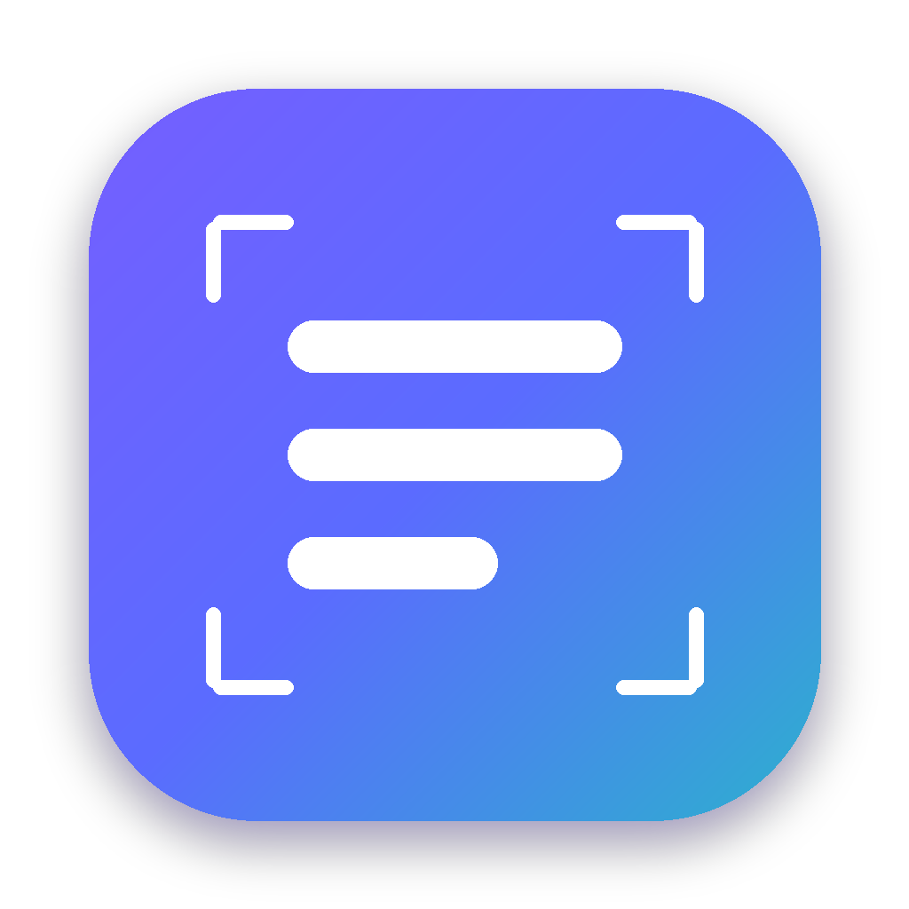
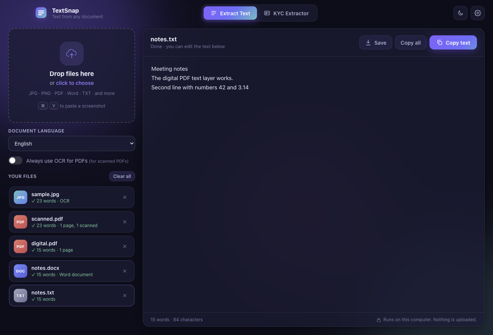
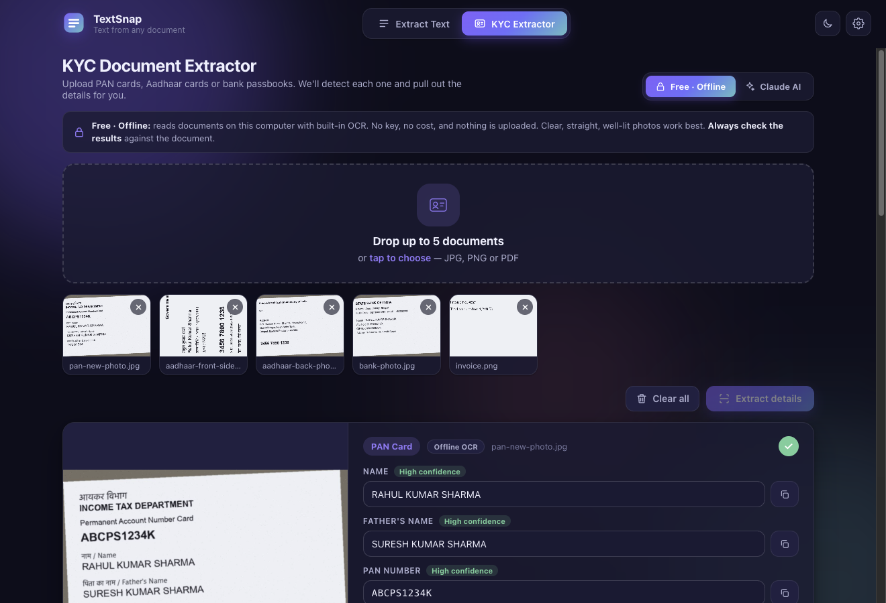

<p align="center">
  
</p>

<h1 align="center">TextSnap</h1>
<p align="center"><b>Get the text out of any photo, scan, PDF or document, then copy and paste it anywhere.</b><br/>
Built-in OCR · Works offline · macOS &amp; Windows</p>

<p align="center"></p>

---

## What it does

TextSnap has two tabs:

### 1. Extract Text (works offline)
- Drop in **JPG, JPEG, PNG, WEBP, BMP, GIF, TIFF, PDF, Word (.docx), TXT, Markdown, CSV, HTML, RTF** and more.
- **OCR built in.** Photos, screenshots and scanned PDFs are read on your computer, with nothing uploaded.
- Digital PDFs are read directly (fast and exact). Scanned pages switch to OCR automatically.
- **Paste a screenshot** with <kbd>⌘</kbd>/<kbd>Ctrl</kbd> + <kbd>V</kbd>.
- Edit the text, then **Copy** with one click or **Save** as a `.txt` file.
- 20 languages, including Hindi, Marathi, Gujarati, Bengali, Tamil, Telugu, Kannada, Punjabi and Urdu. English is built in; other languages download once (a few MB) the first time you use them.
- Light and dark mode.

### 2. KYC Extractor (free offline mode, or Claude AI)
<p></p>

Choose how documents are read with the switch at the top of the tab:

| | **Free · Offline** (default) | **Claude AI** |
|---|---|---|
| Cost | Free | A little per document (pay-as-you-go API credit) |
| Needs an API key | No | Yes |
| Where documents go | Never leave the computer | Sent to the Claude API to be read, never stored |
| Best for | Clear, straight, well-lit photos and scans | Blurry, angled, glare-y or low-quality photos |

Free mode reads the document with the built-in OCR (English + Hindi), then finds each field by its label and format. Sideways or upside-down photos are rotated automatically. It is less accurate than Claude AI on difficult photos, so **always check the results**. The format checks and Aadhaar checksum still flag most misread numbers.

- Upload up to **5** documents at once (JPG, PNG or PDF). Each one gets a preview and a remove button.
- Detects **PAN card**, **Aadhaar card** or **Bank passbook** automatically. If it isn't sure, it says **Unknown document** instead of guessing.
- Extracts:
  - **PAN:** Name, Father's Name, PAN Number, Date of Birth
  - **Aadhaar:** Name, Father's Name, Aadhaar Number, Address
  - **Bank passbook:** Account Holder Name, Account Number, IFSC Code, Bank / Branch name
- **Accuracy rules:**
  - Text is copied exactly as printed. Spelling is never corrected or completed.
  - Anything blurred, cut off or half visible shows as **UNREADABLE** in red. It is never guessed.
  - A field that isn't printed on the card (e.g. father's name on many Aadhaar cards) shows **NOT FOUND**.
  - **Double-check mode** (Claude AI mode, on by default) reads every document twice, separately. If the two reads disagree on any character, the field is marked *Low confidence* and *Please verify*.
  - **Format checks:** PAN = 5 letters + 4 digits + 1 letter, Aadhaar = 12 digits (plus the official Aadhaar checksum, which catches a single misread digit), IFSC = 4 letters + 0 + 6 letters/digits. A failed check shows a *Please verify* warning. The value itself is never changed.
  - Aadhaar, PAN, IFSC and account numbers come out without spaces (e.g. `123412341234`), ready to paste into forms.
  - Answers come back as strict JSON, with a **High / Low** confidence on every field.
- Every field is **editable** and has its own **Copy** button. There is also *Copy all fields*.
- **Privacy:**
  - Documents are never saved to disk. They exist only in the app's memory.
  - The Aadhaar number is **masked** (`XXXX XXXX 1234`) until you press **Show**.
  - **Clear all** deletes every document and result immediately.

---

## Install (for everyone)

Download the installer from the **[Releases](../../releases)** page.

### macOS
1. Download **`TextSnap-x.y.z-mac.dmg`** (works on Apple Silicon and Intel Macs).
2. Open it and drag **TextSnap** into **Applications**.
3. The first time only: **right-click TextSnap → Open → Open**. The app isn't signed with a paid Apple certificate, so macOS asks once.
   - If macOS says the app *"is damaged"*, open **Terminal** and run the command below, then open the app again.

```bash
xattr -cr /Applications/TextSnap.app
```

### Windows
1. Download **`TextSnap-Setup-x.y.z.exe`**.
2. Double-click it. TextSnap installs and opens by itself, and adds a desktop shortcut.
   - If Windows SmartScreen appears, click **More info → Run anyway** (the app isn't signed with a paid certificate).

---

## Optional: add an API key for Claude AI mode

**You don't need a key to use TextSnap.** The Extract Text tab and the KYC Extractor's **Free · Offline** mode work without one.
A key is only needed for the KYC Extractor's **Claude AI** mode.

A ChatGPT, Gemini or Claude.ai Pro subscription does **not** include an API key. API usage is billed separately, as prepaid credit. To get a key:

1. Create a key at **[console.anthropic.com → API keys](https://console.anthropic.com/settings/keys)** and add some credit.
2. In TextSnap, click the **⚙ Settings** button (top-right), paste the key, and click **Save**.

The key is encrypted with your computer's keychain (macOS Keychain / Windows DPAPI) and is only sent to Anthropic.
Each document costs one API request, or two with Double-check on. You can turn Double-check off for lower cost.

---

## For developers

Requires **Node.js 20+**.

```bash
npm install
```

```bash
npm start
```

Build installers locally:

```bash
npm run dist:mac
```

```bash
npm run dist:win
```

Installers appear in `dist/`.

### Automatic builds on GitHub
`.github/workflows/release.yml` builds the Mac and Windows installers on GitHub's servers.

- **Make a release:** push a version tag. The installers are attached to a new GitHub Release automatically.

```bash
git tag v1.0.0
```

```bash
git push origin v1.0.0
```

- **Just test a build:** open the **Actions** tab → *Build installers* → **Run workflow**, then download the files from the run.

### Project layout
```
src/
  main/
    main.js     app window, menus, settings, file save, clipboard
    ocr.js      offline OCR engine (tesseract.js) + language packs
    kyc.js      KYC extraction with the Claude API (strict JSON, double-check)
  preload.js    safe bridge between the window and the app
  renderer/
    index.html  layout
    styles.css  design (light/dark, animations)
    app.js      tabs, theme, settings
    textTab.js  Extract Text tab
    kycTab.js   KYC Extractor tab
    kycParse.js free offline mode: finds PAN / Aadhaar / bank fields in OCR text
    validate.js PAN / Aadhaar (Verhoeff checksum) / IFSC format checks
    files.js    PDF rendering, image decoding, thumbnails
build/icon.png  app icon (converted for macOS/Windows during the build)
```

### Tech
Electron · tesseract.js (OCR) · PDF.js · mammoth (Word) · Anthropic SDK (`claude-opus-5-5`, structured outputs).

> Note: the KYC tab asks the model for strict JSON through structured outputs. Current Claude models don't accept a `temperature` setting, so consistency comes from the strict schema, the rules in the prompt and the two-read double check.

## License
MIT
